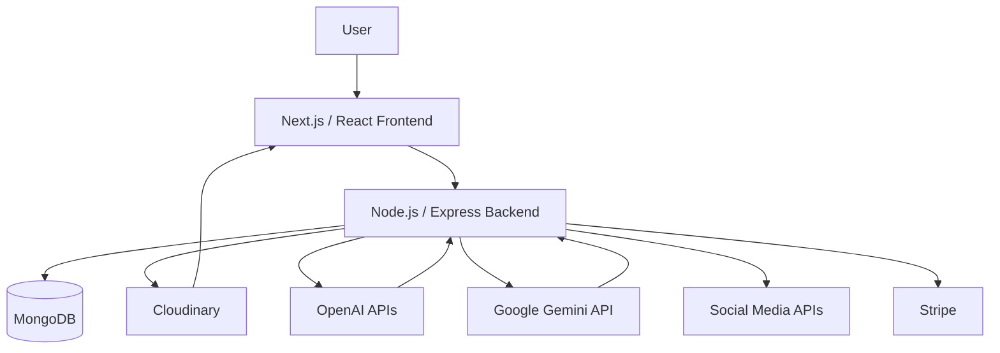

# MAVEED — AI Video Automation Platform

## Overview

MAVEED is an AI-powered Software as a Service (SaaS) platform designed to simplify multimedia content creation, video production, and social media publishing.

The platform enables users to generate images and videos using artificial intelligence, create reusable characters, produce complete series and short films, and publish content directly to their connected social media accounts.

The name MAVEED is inspired by "My Video", reflecting the platform's focus on personalized video creation.

---

## Key Features

### AI Image & Video Generation

- Text-to-Image generation using Google Gemini (Nano Banana).
- Text-to-Video generation using OpenAI Sora.
- Image-to-Video generation using reference images and text prompts.
- Customizable video duration and aspect ratio.
- Landscape and vertical video formats.
- Reusable AI-generated avatars and characters.

### Social Media Integration

- YouTube
- Instagram
- Facebook
- TikTok

Users can connect their social media accounts through OAuth authorization and publish generated content directly from MAVEED, without manually downloading and uploading media files.

Platform-specific account requirements and publishing restrictions are taken into consideration.

### AI Creative Studio

An intelligent studio designed for creating series and short films.

- AI-powered storyline generation.
- Automatic episode and scene decomposition.
- Character selection and reuse.
- Structured screenplay generation using GPT.
- Individual scene generation.
- Scene merging into complete episodes.
- Episode merging into a final video.

### Voice-Controlled Generation

Users can generate multimedia content through natural voice commands.

The workflow combines:

1. Audio recording.
2. Speech-to-Text transcription.
3. AI-powered intent recognition.
4. Structured parameter extraction.
5. Image or video generation.

### Personal Media Library

- Centralized access to generated images and videos.
- User-specific content management.
- Cloud-based multimedia storage.
- Media visualization and retrieval.

### Authentication and Payments

- User registration and authentication.
- Google Sign-In integration.
- JWT-based authentication.
- Stripe payment integration.

### Internationalization

Multilingual interface designed to reach an international audience, including French, English, Spanish and German.

---

## Technology Stack

| Category | Technologies |
|----------|-------------|
| Frontend | Next.js, React, TypeScript |
| UI & Styling | Tailwind CSS |
| Backend | Node.js, Express.js |
| Database | MongoDB, Mongoose |
| Media Storage | Cloudinary |
| Artificial Intelligence | OpenAI GPT, Sora, Google Gemini, Nano Banana |
| Speech Recognition | OpenAI Speech-to-Text |
| Payments | Stripe |
| Authentication | JWT, bcrypt, Google Sign-In |
| Social Media | YouTube Data API, Meta APIs, TikTok API |
| API Communication | REST APIs, Axios, JSON |
| Authorization | OAuth 2.0 |
| Version Control | Git, GitHub |

---

## System Architecture



The application follows a client-server architecture with a clear separation between the user interface, business logic, persistent data, multimedia storage and external services.

---

## Technical Challenges and Solutions

### 1. Database Performance Optimization

Initially, multimedia files were stored directly in the database. As the volume of generated content increased, this approach caused significant loading and performance issues.

To address this problem, the storage architecture was redesigned:

- Images and videos are stored in Cloudinary.
- MongoDB stores media URLs and associated metadata.
- Multimedia storage is separated from business data.

This approach reduces database load and improves media retrieval.

### 2. External AI API Integration

Integrating multiple AI providers required understanding their specific request parameters, authentication mechanisms, response structures and generation workflows.

The integration involved:

- Request parameter validation.
- JSON response processing.
- Reference image management.
- Asynchronous generation handling.
- Provider-specific constraints.
- API cost considerations.

### 3. Social Media API Integration

Social media integration introduced several technical and administrative challenges:

- OAuth authorization flows.
- Access token management.
- Platform-specific permissions.
- Developer application configuration.
- Sandbox and production environments.
- Application review and verification procedures.

User documentation was also introduced to explain platform-specific requirements, particularly for Instagram professional accounts.

### 4. AI Workflow Orchestration

The creative studio combines multiple AI services to transform a general idea into a structured multimedia production.

GPT generates the storyline, episodes and scenes, while video generation services produce the corresponding multimedia content.

MongoDB references associate characters, scenes, episodes and series.

---

## Project Structure

```text
myveed-saas/
├── backend/
│   ├── src/
│   │   ├── controllers/
│   │   ├── models/
│   │   ├── routes/
│   │   ├── services/
│   │   ├── middlewares/
│   │   └── server.js
│   └── package.json
│
├── frontend/
│   ├── app/
│   ├── components/
│   ├── services/
│   └── package.json
│
└── README.md
```

---

## Getting Started

### Prerequisites

- Node.js
- npm
- MongoDB
- Cloudinary account
- Required external API credentials

### Backend

```bash
cd backend
npm install
cp .env.example .env
npm run dev
```

Configure the required environment variables before starting the backend.

### Frontend

```bash
cd frontend
npm install
cp .env.local.example .env.local
npm run dev
```

Open:

http://localhost:3000

---

## Security

Sensitive configuration, API credentials and authentication secrets must be managed through environment variables.

Never commit real API keys, access tokens or database credentials to the repository.

---

## Project Objectives

- Simplify AI-powered content creation.
- Automate multimedia production workflows.
- Centralize social media publishing.
- Reduce repetitive manual operations.
- Provide an accessible creative environment for international users.
- Optimize infrastructure and external API costs.

---

## License

MIT

---

**MAVEED — Create. Automate. Publish.**
